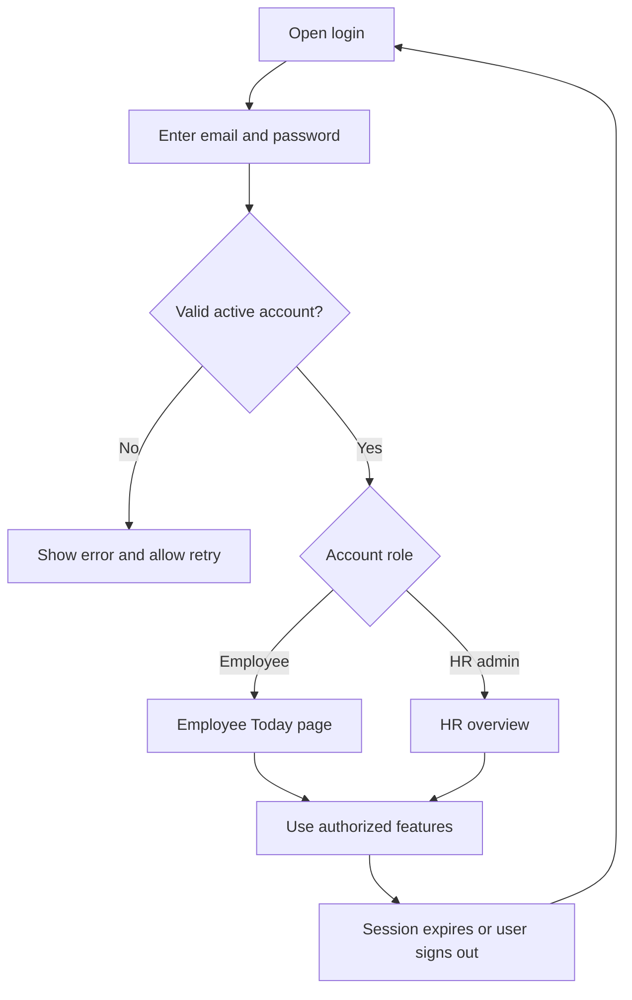
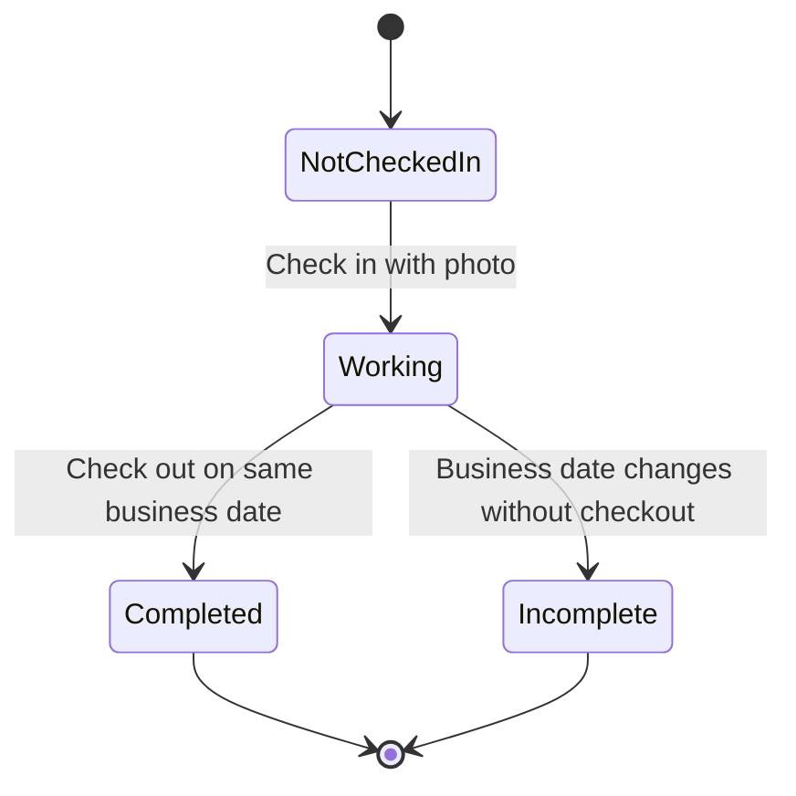

# Features and Workflows

[Setup guide](./README.md) | [Technical documentation](./TECHNICAL_DOCUMENTATION.md)

## Purpose

The system lets employees record WFH arrival/departure with photos and lets HR admins manage employees and review attendance. It shows the time between recorded check-in and check-out; it does not continuously track activity or prove that every recorded minute was actively worked.

## Roles and permissions

| Capability                         | Employee                             | HR admin                                  |
| ---------------------------------- | ------------------------------------ | ----------------------------------------- |
| Log in and view own session        | Yes                                  | Yes                                       |
| Submit employee check-in/check-out | Own attendance                       | No                                        |
| View employee profile              | Own summary                          | Employee management screens               |
| View attendance and photos         | Own records                          | All employees                             |
| View work duration                 | Own daily and filtered-period totals | Employee daily and filtered-period totals |
| View HR overview charts            | No                                   | Yes                                       |
| Add/edit employee accounts         | No                                   | Yes                                       |
| Activate/deactivate employees      | No                                   | Yes                                       |
| Edit/delete/approve attendance     | No                                   | No                                        |

Role checks run on the backend as well as in frontend navigation. HR accounts do not become employee attendance accounts simply by having admin access.

## Login and session flow

Login has a show/hide password control and submit feedback. Invalid credentials receive a generic message rather than identifying whether the email exists. Inactive users cannot log in. Repeated attempts can reach the login rate limit.

An access token lasts one hour by default. After expiry, the user signs in again. Signing out clears the local session and authenticated cache; it is not a password change.

Fresh database demo accounts:

- HR admin: `hrd@example.test` / `password`.
- Employees: `employee001@example.test` through `employee010@example.test` / `password`.

Environment overrides and existing account passwords take precedence. Reseeding does not reset passwords. See README if demo login fails.

## Employee experience

### Today dashboard

The dashboard shows the business date/timezone, attendance status, a check-in/check-out timeline, work-time target indicators, total completed work time, and a read-only profile summary. Submitted photos can be viewed after attendance is recorded.

If an older record has no check-out, a notice links to the latest previous incomplete attendance. It does not prevent starting a new day's attendance.

### Check-in

1. Open the Today page while signed in as an employee.
2. Select **Check in now**.
3. Choose a supported photo from the gallery/device. The input does not force camera capture.
4. Review the preview. Replace or remove the selected file if needed.
5. Optionally enter a note, then submit.
6. The server records the official timestamp and business date.
7. The interface confirms the result, shows the recorded time/photo, and offers check-out.

Only one check-in is permitted per employee per business date. Repeated or simultaneous submissions do not create extra attendance rows.

### Check-out

1. Open today's existing check-in.
2. Select **Check out now**.
3. Choose a proof photo and optionally add a note.
4. Submit and wait for confirmation.
5. The record becomes Completed and its work duration is finalized.

Check-out requires a same-day check-in. Duplicate checkout is rejected. A successful checkout does not permit another check-in on that date.

### History and attendance detail

History supports a date-range filter and pagination. Each record shows the date, check-in/out times, status, and work duration. A period summary shows recorded days, completed records, current Working records, prior-day Incomplete records, and accumulated completed work time.

Totals cover **all records matching the date filter**, including pages that are not currently visible. Opening a record shows its notes, time-target indicators, total duration, and private proof photos. The photo viewer supports enlargement and keyboard dismissal.

Employees cannot browse another employee's history or photos by changing the URL.

## Attendance lifecycle

This diagram represents one employee's single business-date record. A new business date has its own attendance cycle.

| UI label       | Meaning                                         | Check-out                            | Included in work-time totals? |
| -------------- | ----------------------------------------------- | ------------------------------------ | ----------------------------- |
| Not checked in | No record for today                             | Not available yet                    | No                            |
| Working        | Check-in exists for today                       | Still available today                | No, duration is not final     |
| Incomplete     | A previous business date ended without checkout | Remains empty; no overnight checkout | No                            |
| Completed      | Both timestamps recorded                        | Already recorded                     | Yes                           |

**Example:** An employee checks in on 30 October and forgets to check out. On 31 October, the old record displays Incomplete instead of Working. No automatic 17:00 checkout is created, and its duration remains empty. The employee can still check in for 31 October.

An empty day in the HR recap means no submitted attendance record. It is not automatically classified as absent, sick, on leave, or on holiday.

## Work hours and time rules

Business timezone defaults to **Asia/Jakarta (WIB)** and is configurable on the backend. Server timestamps are authoritative. Display dates and the midnight rollover follow the configured business timezone.

Working-time targets are **08:00** check-in and **17:00** check-out. The current implementation compares time at minute precision: 08:00 is on target, 08:01 is late, and checkout before 17:00 is early. These indicators do not block attendance submission.

Work duration is the elapsed check-in-to-check-out interval:

| Example                                  | Result                              |
| ---------------------------------------- | ----------------------------------- |
| 08:00 to 17:00                           | `9h 00m`                            |
| 08:15 to 17:00                           | `8h 45m`                            |
| 08:00 to 16:30                           | `8h 30m`                            |
| Completed interval below one minute      | `<1m`                               |
| Several completed days totaling 45 hours | `45h 00m`                           |
| Check-in without checkout                | Dash; excluded from completed total |

No lunch/rest break is deducted. Hours are not capped at the schedule target, and the system does not label overtime or calculate pay. Display is in hours/minutes; the backend keeps computed whole seconds so totals are not based on rounded display strings.

## HR admin experience

### Overview dashboard

The overview shows active/inactive employee counts, today's check-ins, completed records, and attendance trend charts for the last seven dates by default. Cards link to employee or monitoring views. Only submitted attendance is counted; no automatic absence inference is made from missing records.

### Employee list

HR can search by name, employee ID, or email; filter active/inactive accounts; sort by name or employee number; choose row count; and navigate pages. URL filter state helps preserve the current list when opening and returning from an editor.

### Add employee

1. Open **Employees**, then the add action.
2. Fill fields marked `*`: full name, employee ID, email, department, and initial password.
3. Optionally fill position and phone.
4. Review validation feedback and submit.
5. The system creates a linked login account and employee profile, then returns to the list with success feedback.

Passwords require at least eight characters. Email and employee ID must be unique. The system identifies the conflicting field when a duplicate is rejected. There is no automatic email invitation; HR shares the initial credentials outside the application.

### Edit employee

Open an employee, change permitted profile fields, and save. The form has validation, required markers, dirty-state handling, and protection against accidental navigation with unsaved changes. Optional position/phone fields can be cleared. Editing does not reset the employee's password or change their role.

### Activate/deactivate

HR can deactivate an employee after reviewing the confirmation dialog. Deactivation prevents further protected access, including use of an already issued token. Existing attendance and proof photos remain available to HR. HR can reactivate the account later.

Deactivation is not physical deletion. This preserves historical records and audit links.

### Attendance monitoring filters

HR can select:

- **Date range** or **Monthly** period mode.
- An employee through a searchable picker, or all employees.
- All statuses, Working, Incomplete, or Completed.
- Row count and pagination.
- **Recap** or **List** view.

Reset restores the page's default filters. The default date-range view looks back one calendar month through today; Monthly uses the selected month's boundaries. Date ranges must be ordered. Recap supports at most 62 inclusive dates.

### List view

Each row shows employee, date, check-in/out, work time, status, and a detail link. The filtered work-time total covers all matching rows across pages. Select one employee to inspect that employee's total for the chosen period. Incomplete records show missing checkout rather than suggesting the employee is still working.

### Recap view

The matrix has employee rows and calendar-date columns. Employee names and date headers remain visible while scrolling, and weekends are visually highlighted for reference. Pagination operates on employees rather than individual attendance rows.

| Badge | Meaning                                                         |
| ----- | --------------------------------------------------------------- |
| C     | Completed                                                       |
| W     | Working on the current business date                            |
| I     | Incomplete prior-day attendance                                 |
| L     | Late check-in indicator; can appear with a record's main status |
| Dash  | No matching submitted record                                    |

Recorded cells show times and completed duration; employee identity cells show the selected-period total. Status filters affect the visible records and totals. Clicking a day opens the read-only detail, notes, photos, and duration.

## Photos, errors, and feedback

- Both actions require a photo. Supported formats: static JPEG, PNG, WebP.
- Default size limit: 5 MB. Corrupt, unsupported, animated, or excessively large-dimension images are rejected.
- Upload previews, replacement/removal, progress, and submit feedback support the attendance flow.
- Duplicate actions and invalid transitions show business errors rather than silently overwriting data.
- If an upload response is uncertain, the attendance flow checks the server state to reduce accidental duplicate retries.
- Loading, empty, retryable error, and success states are shown throughout the application.
- Private photos require authenticated access; knowing a photo URL alone is insufficient.
- Access errors include a request ID that can be used to trace the backend operational log.

## Suggested demonstration

1. Start MySQL, API, and frontend using the root README.
2. Log in as an employee and show the Today dashboard/profile.
3. Check in with a proof photo, then inspect the recorded timestamp.
4. Check out with a proof photo; show Completed and the elapsed duration.
5. Open history, change the date filter, and inspect the filtered total and photos.
6. Log out and log in as HR admin.
7. Show employee counts/charts, employee search, and the add/edit form.
8. Open monitoring, switch Monthly/Date range and Recap/List, and select an employee.
9. Inspect that employee's daily duration and period total, then open record details.
10. If historical incomplete records already exist, use the Incomplete filter to show them. A fresh seed does not create these records or attendance photos.

For automated lifecycle scenarios, use development-only tests described in the technical documentation. Do not change ordinary business data just to manufacture a demonstration.

## Current scope boundaries

Implemented: employee attendance, gallery proof photos, own history/profile summary, HR employee management, account activation, dashboards, read-only monitoring, work durations, incomplete status, validation, role/ownership checks, and backend audit/access logs.

Not implemented: GPS/geofencing, face recognition, forgotten-password/email reset, employee self-service profile editing, leave/sick/holiday management, attendance correction/approval, overnight shifts, payroll/overtime rules, report export, and notification delivery. Audit logs are stored in the backend database; there is no dedicated audit-log browsing screen.
