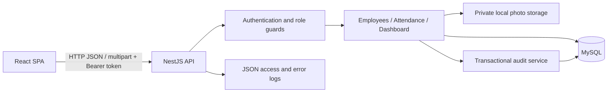
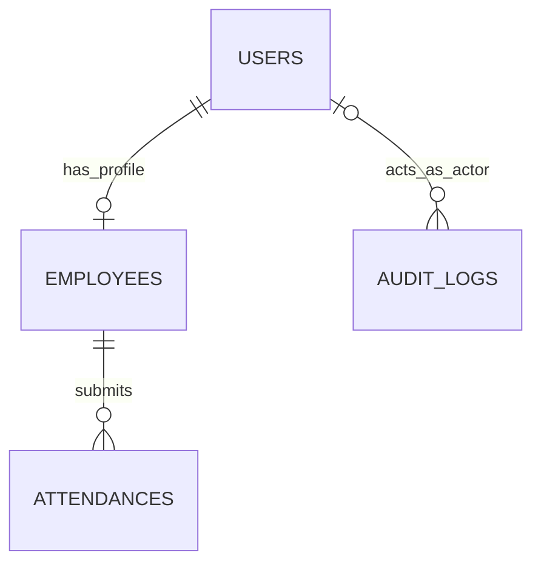

# Technical Documentation

[Setup guide](./README.md) | [Features and workflows](./FEATURES_AND_WORKFLOWS.md)

This document describes the implemented system. The `ARCHITECTURE.md` files inside each application also contain historical design plans; proposed items there are not automatically implemented features.

## Architecture

The repository contains two independent npm applications. The backend is a **modular monolith**: modules run in one NestJS process and share one MySQL database. This follows the clarified requirement for clean module separation. There is no distributed microservice deployment, message broker, or Docker requirement.



Typical backend request flow:

```text
Request
  -> request ID and access-log middleware
  -> rate limit / JWT / role guards, as configured on the route
  -> DTO validation and parameter pipes
  -> controller
  -> business service
  -> TypeORM query / database transaction
  -> response
```

The global exception filter handles failures. Access middleware records response completion or disconnection, including guard rejections. Photo-upload routes additionally use Multer interceptors.

## Technology and library choices

Version ranges below come from the application manifests. Lockfiles determine the exact installed dependency tree; use `npm ci` to reproduce it.

| Backend area       | Technology                                                    | Purpose                                                                    |
| ------------------ | ------------------------------------------------------------- | -------------------------------------------------------------------------- |
| Runtime/framework  | Node.js, NestJS 11, TypeScript 5                              | Modules, controllers, services, dependency injection, typed implementation |
| HTTP adapter       | `@nestjs/platform-express`                                    | Express integration and multipart handling through Multer                  |
| Database           | MySQL 8, TypeORM 0.3, `@nestjs/typeorm`, `mysql2`             | Entities, repositories, queries, transactions, migrations                  |
| Authentication     | `@nestjs/jwt`, `@nestjs/passport`, `passport`, `passport-jwt` | JWT creation and bearer-token authentication                               |
| Password hashing   | `argon2`                                                      | Hash and verify passwords                                                  |
| Request validation | `class-validator`, `class-transformer`                        | DTO constraints, normalization, query conversion                           |
| Configuration      | `@nestjs/config`, Joi, dotenv                                 | Environment loading and startup configuration checks                       |
| HTTP protection    | Helmet, `@nestjs/throttler`                                   | Security headers and request limits                                        |
| Photos             | Sharp                                                         | Decode, validate, orient, and re-encode image uploads                      |
| API documentation  | `@nestjs/swagger` and compiler plugin                         | OpenAPI request/response schemas and Swagger UI                            |
| Reactive support   | RxJS, reflect-metadata                                        | Nest framework integration                                                 |
| Tests/tooling      | Jest, ts-jest, ts-node, ESLint, Prettier                      | Unit tests, scripts, linting, formatting                                   |

| Frontend area    | Technology                                   | Purpose                                                     |
| ---------------- | -------------------------------------------- | ----------------------------------------------------------- |
| UI/build         | React 19, TypeScript 5, Vite 7               | SPA rendering, type checking, development server, bundling  |
| Navigation       | React Router 7                               | Role-protected screens, route state, navigation blocking    |
| Server state     | TanStack Query 5                             | Requests, cache, mutation invalidation, loading/error state |
| HTTP             | Axios                                        | Shared API client, bearer header, session-expiry handling   |
| Forms            | React Hook Form 7, Zod 4, hookform resolvers | Employee form schema validation and server field errors     |
| Date/time        | date-fns 4, date-fns-tz 3                    | Calendar filters and backend-supplied business timezone     |
| Styling/icons    | Tailwind CSS 4, shared CSS, Lucide React     | Responsive layouts, consistent controls and icons           |
| Tests/formatting | Vitest 5, Prettier                           | Node-based date/duration tests and code formatting          |

Frontend tests do not use jsdom or React Testing Library. Backend tests do not require Supertest or `@nestjs/testing`; HTTP scripts use Node's native `fetch`.

## Source structure

```text
dexa-presensi-api/
  src/
    main.ts                         Bootstrap, /api prefix, CORS, validation, Swagger
    app.module.ts                   Configuration and global providers
    common/                         Middleware, guards, filter, shared DTOs and decorators
    database/
      entities/                     User, Employee, Attendance, AuditLog
      migrations/                   Explicit database schema changes
      data-source.ts                TypeORM CLI configuration
      seed.ts                       Demo accounts and employee profiles
    modules/
      auth/                         Login, JWT strategy, current user
      employees/                    Employee administration
      attendance/                   Attendance operations, policy, history, recap
      files/                        Private photo validation and access
      dashboard/                    Separate module/controller/service/query DTO files
      audit/                        Transactional audit writer
  test/                             HTTP smoke, hardening, disposable UI fixtures
  storage/                          Ignored local uploads, created when needed

dexa-presensi-fe/
  src/
    app.tsx                         Application routes
    app/Guard.tsx                   Frontend access guard
    pages/                          Employee and HR route screens
    features/attendance/            Attendance action and evidence viewer
    features/monitoring/            Recap and dashboard API contract
    components/ui/                  Shared controls, statuses, pagination, modals
    components/layout/              Shell and page header
    lib/                            Axios, types, dates, duration, hooks
    state/auth.tsx                  Authentication/session state
    styles.css / polish.css         Shared and responsive styles
```

Controllers translate HTTP input into service calls. Services enforce business rules and coordinate transactions. Entities describe persistence; DTOs describe accepted inputs or documented outputs. Native TypeORM repositories are injected into services; there is no separate custom repository layer.

## Database model



| Table         | Main fields                                                                           | Integrity rules                                                           |
| ------------- | ------------------------------------------------------------------------------------- | ------------------------------------------------------------------------- |
| `users`       | UUID, email, password hash, role, active flag, timestamps                             | Unique email; passwords excluded from default entity selection            |
| `employees`   | UUID, user ID, employee number, name, department, position, phone                     | Unique user ID and employee number; foreign key to users                  |
| `attendances` | UUID, employee ID, work date, check-in/out timestamps, notes, photo keys              | Unique employee/work-date pair; employee foreign key; date/employee index |
| `audit_logs`  | UUID, actor user ID, action, entity type/ID, metadata JSON, request ID, creation time | Actor foreign key; entity lookup index                                    |

HR admin accounts do not require employee profiles. Each employee profile has one login account. Deactivation changes `users.is_active`; it does not delete history. Audit records are business events, not a complete before/after copy of every field. Employee update metadata records changed field names.

Schema changes use migrations with `synchronize: false`. UUIDs are generated for application records. Instants are stored as UTC datetime values; `work_date` is the calendar date derived from `BUSINESS_TIMEZONE`.

## Attendance consistency and calculations

- Check-in records the server time and stores a validated photo before writing attendance and audit inside one database transaction.
- The unique employee/date constraint protects against concurrent duplicate check-ins, beyond the initial service check.
- Check-out acquires a pessimistic row lock in a transaction, verifies the current date has an open record, and writes checkout plus audit atomically.
- If a transaction fails after photo storage, the service attempts to remove that photo. Filesystem writes are not part of the MySQL transaction; a process crash can still leave an orphan file.
- Dashboard counts/trends are read in a `REPEATABLE READ` transaction.
- Official times are supplied by the backend, never accepted as check-in/check-out input from the browser.

`workedSeconds = max(0, floor((checkOutAt - checkInAt) / 1000))`, or `null` without check-out. There is no break deduction, daily cap, payroll, or overtime calculation. Filtered lists aggregate all matching records before pagination. Recap computes selected-period totals per employee. The frontend formats seconds as hours/minutes and permits totals above 24 hours.

Statuses are derived rather than stored in a status column:

| API status       | Meaning                                                                   |
| ---------------- | ------------------------------------------------------------------------- |
| `NOT_CHECKED_IN` | Today endpoint has no record for the employee/date; not an attendance row |
| `CHECKED_IN`     | Current-day check-in has no checkout; UI label Working                    |
| `INCOMPLETE`     | A prior business date has no checkout                                     |
| `COMPLETE`       | Both timestamps exist                                                     |

Status rollover uses the configured business date, without a cron job or automatic check-out. `workingRecords` and prior-day `incompleteRecords` are counted separately. Both unclosed states contribute zero to worked-hour totals.

## API conventions

- Base URL: `http://localhost:3000/api`.
- JSON request bodies, except multipart attendance uploads.
- Protected routes require `Authorization: Bearer <accessToken>`.
- UUID v4 route parameters. Date filters use valid `YYYY-MM-DD` calendar dates and ordered ranges.
- Default pagination: `page=1`, `limit=20`; maximum API limit 100. UI defaults may use 10 rows.
- POST operations return 201. Read/update/deactivate operations return 200 on success.
- Swagger: `/api/docs`. Machine-readable schema: `/api/docs-json`.

### Endpoint reference

| Method | Endpoint                      | Access / purpose                                           |
| ------ | ----------------------------- | ---------------------------------------------------------- |
| GET    | `/health`                     | Public process liveness                                    |
| POST   | `/auth/login`                 | Public; email/password login                               |
| GET    | `/auth/me`                    | Current active user and business timezone                  |
| GET    | `/employees`                  | HR; paginated employee search                              |
| POST   | `/employees`                  | HR; create profile plus login                              |
| GET    | `/employees/:id`              | HR; employee details                                       |
| PATCH  | `/employees/:id`              | HR; edit profile fields                                    |
| PATCH  | `/employees/:id/status`       | HR; activate/deactivate                                    |
| DELETE | `/employees/:id`              | HR; deactivate, not physical deletion                      |
| GET    | `/attendance/today`           | Employee; today and latest previous incomplete record      |
| POST   | `/attendance/check-in`        | Employee; one check-in per business date                   |
| POST   | `/attendance/check-out`       | Employee; same-day checkout                                |
| GET    | `/attendance/me`              | Employee; own history and filtered work summary            |
| GET    | `/attendance`                 | HR; filtered history and work summary                      |
| GET    | `/attendance/recap`           | HR; employee/date matrix and per-employee totals           |
| GET    | `/attendance/:id`             | HR or owner; attendance detail                             |
| GET    | `/files/attendance/:id/:kind` | HR or owner; private photo, kind `check-in` or `check-out` |
| GET    | `/dashboard/summary`          | HR; employee counts, today's counts, and trends            |

All endpoint paths in the table are relative to `/api`.

### Authentication

```http
POST /api/auth/login
Content-Type: application/json
```

```json
{ "email": "hrd@example.test", "password": "password" }
```

The response contains `accessToken` and `user`, including role, business timezone, and an employee summary or `null`. Token lifetime defaults to 3,600 seconds. The frontend stores it in `sessionStorage`, clears authenticated cache on session changes, and returns to login on expiry. There is no refresh token or server-side logout revocation endpoint; local sign-out clears the browser session.

### Employee management

List filters: `search` (name, employee number, email), `status=active|inactive`, `sortBy=fullName|employeeNumber`, `order=ASC|DESC`, `page`, and `limit`.

Create example:

```json
{
  "email": "new.employee@example.test",
  "password": "password",
  "employeeNumber": "EMP-011",
  "fullName": "New Employee",
  "department": "Information Technology",
  "position": "Developer",
  "phone": ""
}
```

Required create fields: email, password (at least 8 characters), employee number, full name, department. Position and phone are optional. Update accepts profile/email fields, not password or role. Omitted update fields are preserved; explicit `null` is rejected. Clear position/phone with an empty string. Activation body: `{"isActive":true}` or `{"isActive":false}`.

### Attendance filters, upload, and responses

History/list filters: `dateFrom`, `dateTo`, `employeeId` (HR list), `status=CHECKED_IN|INCOMPLETE|COMPLETE`, `page`, `limit`. Employee history always forces the authenticated employee ID, regardless of supplied IDs.

Recap requires both dates and allows 1-62 inclusive dates, with employee/status filters and employee pagination. Status filters restrict the matching employee roster and returned records. Dashboard allows 1-31 inclusive dates and defaults to the last 7 dates including today.

Check-in and checkout accept `multipart/form-data`:

| Field   | Constraint                                          |
| ------- | --------------------------------------------------- |
| `photo` | Required static JPEG/PNG/WebP; default maximum 5 MB |
| `note`  | Optional string, maximum 500 characters             |

Attendance records include IDs, work date, derived status, check-in/out timestamps and notes, late/early flags, authenticated photo URLs, and `workedSeconds`. An unclosed record has `checkOutAt: null` and `workedSeconds: null`.

Paginated history/list structure:

```json
{
  "items": [],
  "total": 0,
  "page": 1,
  "limit": 20,
  "summary": {
    "totalWorkedSeconds": 0,
    "completedRecords": 0,
    "incompleteRecords": 0,
    "workingRecords": 0
  }
}
```

Summary values cover all matching rows, not just `items`. Recap returns pagination, selected dates, and employee items with `records` and `totalWorkedSeconds`. Dashboard returns `businessDate`, `timezone`, selected dates, employee counts, today's attendance counts, and daily trends. Exact nested schemas are available in Swagger.

## Validation, authorization, and error handling

The global ValidationPipe uses `whitelist`, `forbidNonWhitelisted`, and `transform`. Unknown body/query fields are rejected. DTOs normalize employee text and email, validate length/type/allowed choices, and transform numeric pagination. Shared date DTOs reject nonexistent dates, timestamp strings, reversed ranges, and explicit null dates. Joi validates environment values, JWT secret length, numeric limits, and the business timezone during startup.

JWT strategy verifies token expiry and looks up the active database account on protected requests. Role guards enforce HR/employee boundaries; attendance services also verify record ownership. Deactivating an account blocks previously issued tokens on subsequent protected requests.

Errors are formatted centrally:

```json
{
  "statusCode": 409,
  "code": "ConflictException",
  "message": "Email is already in use",
  "field": "email",
  "requestId": "4ae9d5c8-ed7e-47db-959e-749f238e4902"
}
```

`field` is included only where supplied, such as employee uniqueness conflicts. `message` may be a string or array of validation messages. Unexpected failures return a generic 500 message rather than a client-visible stack trace.

| HTTP status | Typical cause                                                           |
| ----------- | ----------------------------------------------------------------------- |
| 400         | Invalid fields, UUID, date, or image                                    |
| 401         | Invalid credentials/token, expired token, inactive account              |
| 403         | Wrong role or another employee's record                                 |
| 404         | Record/photo not found                                                  |
| 409         | Duplicate employee data, duplicate attendance, checkout before check-in |
| 413         | Multipart photo exceeds the interceptor limit                           |
| 429         | Request limit reached                                                   |
| 500         | Unexpected backend failure                                              |

## Photos and HTTP protection

Photos use generated UUID filenames in private local storage. Signature checks and Sharp decoding verify content; limits include 25 megapixels, 10,000 pixels per side, and static images only. Re-encoding drops image metadata. Photo routes enforce authorization and return `Cache-Control: private, no-store`. The frontend retrieves authenticated blobs and releases object URLs after use.

The upload interceptor has a 5 MB cap; `MAX_UPLOAD_BYTES` also limits files in the service. Increasing that environment value alone does not raise the interceptor's hardcoded 5 MB cap.

Helmet supplies security headers and CORS allows the configured frontend origin. The default route throttle is 100 requests per 60 seconds; login overrides it to 5 per 60 seconds. Default throttle state is process-local, so multi-instance deployment would need shared limit storage and reviewed proxy/IP configuration.

## Operational logs and audit trail

Access logs are JSON lines containing timestamp, level, context, request ID, method, route, status, duration, and abort flag. They are written once on response `finish` or connection `close`, including 401/403/429 rejections. Levels: `info` for success, `warn` for client errors, `error` for server errors. An early disconnect is logged with synthetic status 499. Request bodies, authorization headers, and query strings are not included by the access logger.

Responses include `X-Request-Id`; error bodies also include the request ID. The exception filter records unexpected server errors with stack traces server-side. Operational output is emitted to stdout/stderr; file rotation, central collection, and retention are deployment concerns.

Audit rows capture actor, action, target entity, metadata, and request ID for employee mutations and attendance actions. They use the same database transaction as the mutation. Failed transactions therefore do not leave successful audit events. Seed bootstrap inserts are separate from normal API audit workflows.

## Frontend behavior

- React Router guards organize role-specific navigation; backend authorization remains authoritative.
- TanStack Query keys track relevant filters/user/business date; mutations invalidate related cached data.
- Attendance screens refresh when the configured business date changes, so prior-day Working statuses are reloaded.
- Employee forms use React Hook Form/Zod, required markers, field errors, submit feedback, and unsaved-change protection. Login uses native form validation.
- Shared controls handle date-range input, pagination, modal keyboard focus, image viewing, and loading/empty/error states.
- HR monitoring supports monthly or date-range mode and Recap/List views; the employee picker uses server-side search, not a Select2 dependency.
- Phone/position strings can be cleared with empty values; employee edit does not expose password reset.

## Environment reference

| Variable                            | Default/example                    | Meaning                                                     |
| ----------------------------------- | ---------------------------------- | ----------------------------------------------------------- |
| `PORT`                              | `3000`                             | API listen port                                             |
| `FRONTEND_ORIGIN`                   | `http://localhost:5173`            | Allowed browser origin                                      |
| `DB_HOST`, `DB_PORT`                | `127.0.0.1`, `3306`                | MySQL address                                               |
| `DB_USER`, `DB_PASSWORD`, `DB_NAME` | Local credentials, `dexa_presensi` | Database access                                             |
| `JWT_SECRET`                        | Random, at least 32 characters     | Token signing key                                           |
| `JWT_EXPIRES_IN_SECONDS`            | `3600`                             | Access-token lifetime                                       |
| `BUSINESS_TIMEZONE`                 | `Asia/Jakarta`                     | Work-date and target-time zone                              |
| `UPLOAD_DIR`                        | `storage`                          | Private upload directory, relative to API working directory |
| `MAX_UPLOAD_BYTES`                  | `5242880`                          | Service upload limit; interceptor cap also applies          |
| `SEED_HRD_EMAIL`                    | `hrd@example.test`                 | New seeded admin email                                      |
| `SEED_HRD_PASSWORD`                 | `password`                         | New seeded admin password; does not reset existing users    |
| `SEED_EMPLOYEE_PASSWORD`            | `password`                         | New demo employee passwords                                 |
| `VITE_API_BASE_URL`                 | `http://localhost:3000/api`        | Public frontend API address                                 |

Use application `.env.example` files as the configuration template. Vite embeds its variables at build time, so rebuild for a changed deployment API URL.

## Testing and quality checks

Run from the API directory:

```bash
npm run build
npm test -- --runInBand
npm run lint
npm run format:check
```

Run from the frontend directory:

```bash
npm run build
npm test
npm run format:check
```

Backend unit tests cover policy/timezone rollover, duration calculations, employee validation/null rejection, request boundaries, and access-log lifecycle behavior. Frontend unit tests cover date/timezone and duration formatting. They do not replace browser UI checks.

`npm run test:smoke` requires a running API, MySQL, applied migrations, and actual active admin credentials in the backend `SEED_HRD_EMAIL` / `SEED_HRD_PASSWORD` environment. It creates temporary employees/attendance, exercises authorization, state transitions, photos, summary/recap filters, duration aggregation across pagination, and incomplete statuses, then cleans up its records/files.

`npm run test:hardening` requires compiled backend output, MySQL, migrated/seeded development data, and valid admin credentials. It starts its own API on port 3001 (override `TEST_PORT`), runs the smoke script, then checks invalid inputs, exactly-once access logs for 400/401/403/429, schemas for 18 API operations, and rejection of invalid startup timezone. It expects active `employee001@example.test` with the configured demo employee password. The script stops its own child API.

Do not assume environment seed values match an account if its password was changed separately. Use a development database for scripts that create test fixtures. Manual browser checks should include both roles, mobile layout, upload replacement, filter interactions, keyboard access, and session expiry.

## Deployment boundaries and limitations

Serve the built SPA with an `index.html` fallback for client-side routes. Configure the API CORS origin and frontend build-time API URL consistently. Use HTTPS, managed secrets, durable private storage, backups, log retention, and suitable process supervision for production.

Current limitations include local single-server photo storage, process-local throttling, no distributed tracing/metrics backend, a liveness-only health endpoint, and no refresh tokens or server-side logout revocation. Overnight shifts, retrospective attendance corrections, GPS, forgotten-password recovery, leave management, and payroll are outside the implemented scope.
